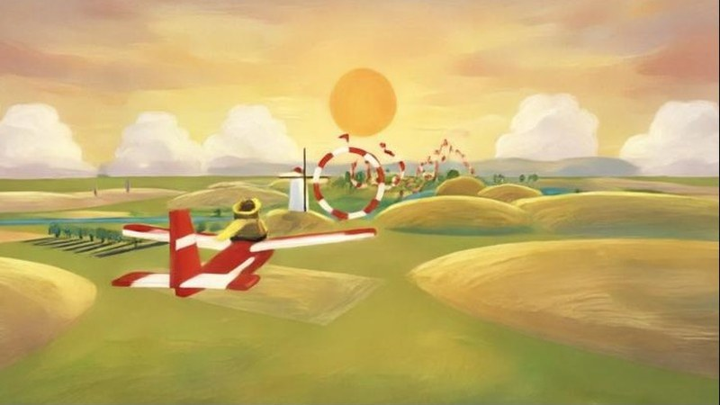
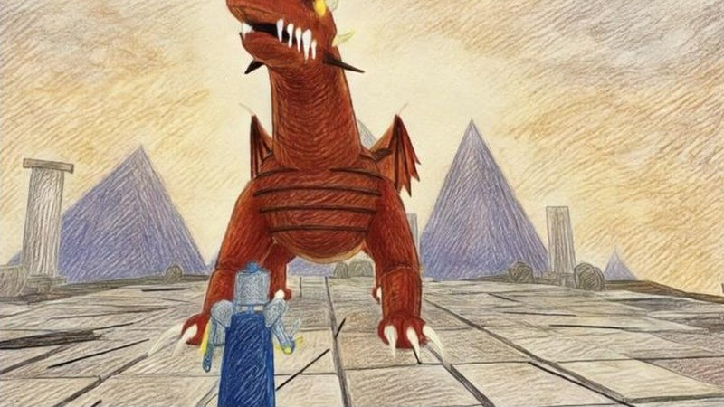
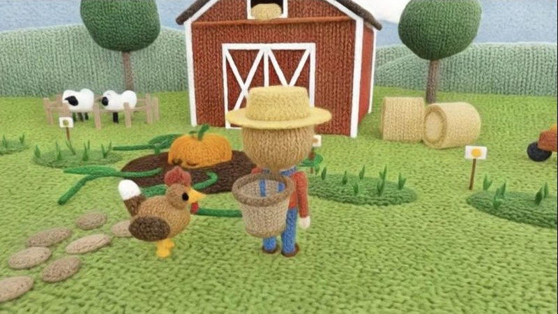
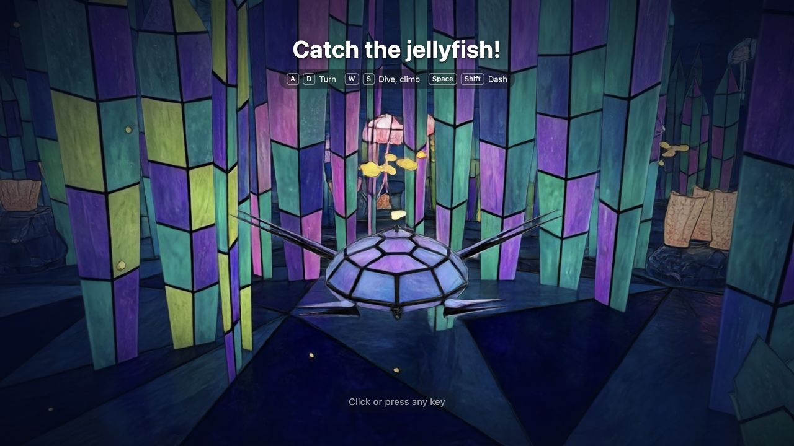
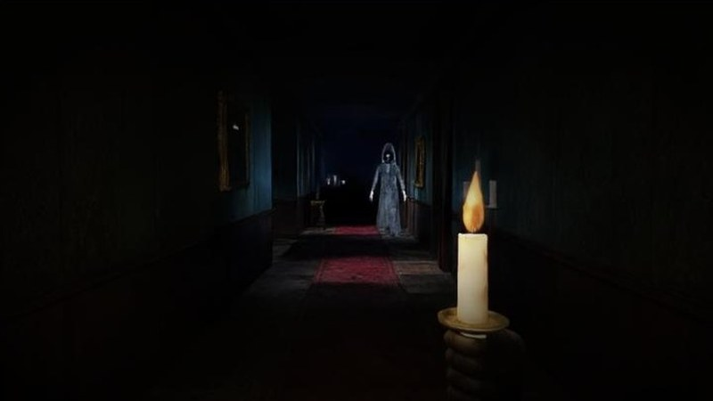

# Dewdrop starter games

Five small three.js games to start a Dewdrop game from, each with its own
look.

| | |
|---|---|
|  | **Golden Glide** (`golden-glide`): fly a wooden glider through wind rings over golden countryside at sunset, in gouache. |
|  | **Ember Wyrm** (`ember-wyrm`): a knight against a huge red dragon on a ruined cliff top, in colored pencil. |
|  | **Woolly Farm** (`woolly-farm`): till, plant and harvest a knitted farm until the giant pumpkin wakes, in wool and felt. |
|  | **Turtle Tide** (`turtle-tide`): a sea turtle catches jellyfish through an endless kelp forest at night, in stained glass. |
|  | **Hollow Manor** (`hollow-manor`): light the candelabras down a haunted hallway in first person, in gothic horror. |

## Start from one

```sh
npx dewctl init                            # then choose one
npx dewctl init --template golden-glide    # or name it: golden-glide, ember-wyrm,
                                           # woolly-farm, turtle-tide or hollow-manor
```

Each folder is a whole project. Its README says how the game works and why
its look works on Dewdrop: the prompt clause by clause, the colours, the
words, the shapes and the camera.

Frames of each on Dewdrop: https://alpha.dewdrop.world/docs/starters. More
looks and what makes them work: https://alpha.dewdrop.world/docs/recipes.
